# [C++/MFC] Shos.MiniCadSample

[English](README.md) | 日本語

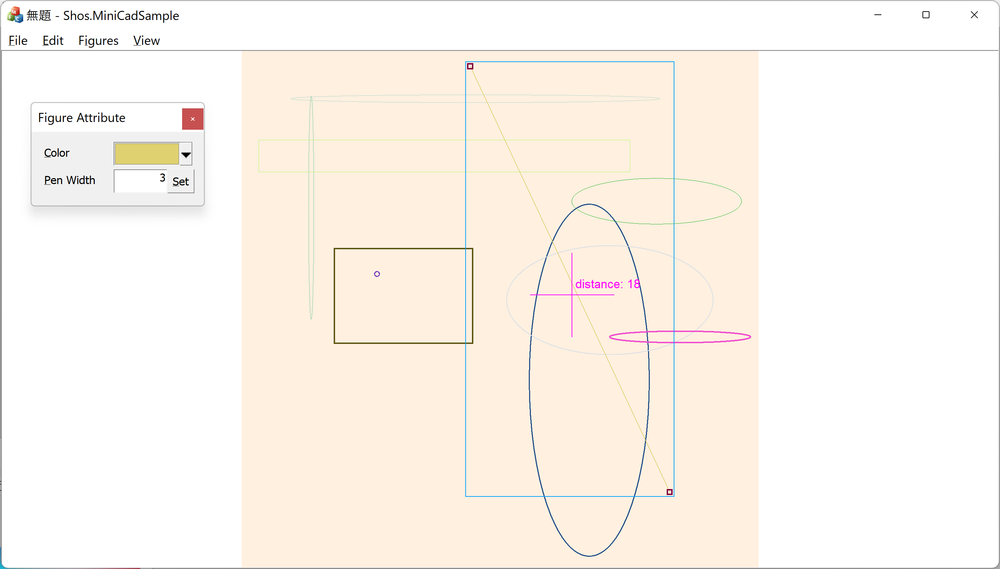

**C++20 と MFC** で書かれた、小さな 2D CAD アプリケーションです。点・線分・矩形・楕円を描くことができ、選択、Undo/Redo、ズームとパン、ファイルの保存と読み込み、クリップボードへのコピーと貼り付けに対応しています。

このアプリケーションは、あえて小さく作ってあります。中級の C++ / MFC / Win32 プログラマー向けの**教材サンプル**です。どの機能も、設計の考え方や Windows の技法を読みやすいコードで示しています。すべてのソースファイルに英語のコメントがあり、ロジックの大部分はヘッダーにあるので、1つの機能を1〜2個のファイルで最初から最後まで読み通せます。

この README では、設計を図で説明します。構造はクラス図、「〜したときに何が起きるか」はシーケンス図、入力の処理は状態遷移図で示します。図は GitHub 上で表示されます。ほかのビューアーで読む場合は、[Mermaid](https://mermaid.js.org/) に対応したものを使ってください。

## 目次

- [このサンプルで学べること](#learn)
- [アプリケーションの使い方](#usage)
- [必要な環境、ビルド、テスト](#build)
- [アーキテクチャ](#architecture): 層、実行時のオブジェクト、クラス階層、Observer の接続
- [処理の流れ](#walkthroughs)
  1. [図形を描く（入力からモデルへ）](#walkthrough-1)
  2. [モデルが変わる（モデルから画面へ）](#walkthrough-2)
  3. [図形を選択する](#walkthrough-3)
  4. [Undo / Redo](#walkthrough-4)
  5. [ちらつかない描画](#walkthrough-5)
  6. [座標、ズーム、パン](#walkthrough-6)
  7. [クリップボードとシリアライズ](#walkthrough-7)
  8. [モードレスの属性ダイアログ](#walkthrough-8)
- [おすすめの読む順番](#reading-order)
- [演習](#exercises)

<a id="learn"></a>

## このサンプルで学べること

| テーマ | このサンプルが示すこと | 読むファイル |
|---|---|---|
| **モデルとビューの分離** | モデルはビューを一切呼びません。小さな型安全な Observer テンプレートで変更を通知し、どの図形が変わったかを伝える *ヒント* を渡します。 | `Observer.h`、`Model.h`（`Hint`）、`Document.h`、`View.h`（`OnUpdate`） |
| **ツールの Command パターン** | 各ツール（選択・点・線分・矩形・楕円）は、入力を処理し、自分のラバーバンドを描く `Command` オブジェクトです。ツールの切り替えは、オブジェクトを1つ取り替えるだけです。 | `Command.h` |
| **マウス入力のイベント化** | 生の `WM_LBUTTONDOWN` / `WM_MOUSEMOVE` / ... メッセージを、*クリック*、*カーソル移動*、*ドラッグ開始 / ドラッグ中 / ドラッグ終了 / ドラッグ中止* に変換します。コマンドが生のメッセージを見ることはありません。 | `MouseEventTranslator.h` |
| **Undo / Redo** | 汎用的で例外安全な Undo/Redo コンテナー（STL スタイル、トランザクション付き）が図形を所有します。変更は「図形を、編集した複製で置き換える」ことで行い、それによって Undo できるようになります。 | `undo_redo_vector.h`、`Model.h` |
| **ちらつかない描画** | 再利用できる、2層構成のダブルバッファリング ライブラリです。図形はキャッシュしたビットマップに、ラバーバンドとカーソルは描画のたびに描き直す層に描きます。 | `DoubleBuffer.h` |
| **座標系** | 論理座標（モデル）とデバイス座標（ピクセル）、`MM_ISOTROPIC` のマッピング、マウス位置を中心にしたズーム、パン。 | `Zooming.h`、`Geometry.h`、`View.h` |
| **クリップボード** | 拡張メタファイル、DIB、登録したカスタム形式の3つの形式で一度にコピーします。貼り付けは「全部成功か、何もしないか」のどちらかで、Undo できます。 | `ClipboardHelper.h`、`Model.h`（`Paste`） |
| **シリアライズ** | ポリモーフィックな図形に `CObject` / `CArchive` / `IMPLEMENT_SERIAL` を使い、ファイルとクリップボードの両方に使います。 | `Figure.h`、`Figure.cpp`、`Model.h`（`Serialize`） |
| **モードレス ダイアログ** | 選択した図形の属性を表示し、*変更*を送り返すツール ウィンドウです。編集した項目だけが反映されます。 | `FigureAttributeDialog.h`、`FigureAttribute.h`、`MainFrame.h` |
| **MFC での現代的な C++** | C++20 のコンセプト、ranges、`std::unique_ptr`、RAII のヘルパー（`GdiObjectSelector`）、層ごとの名前空間、`constexpr`、指示付き初期化子。 | 全体 |
| **MFC アプリのテスト** | モデル、幾何計算、入力の変換、Undo コンテナーの単体テストです。N 回目の `new` を失敗させて、例外安全性とリークを確かめるテストも含みます。 | `Shos.MiniCadSample.Test`、`Shos.MiniCadSample.MemoryLeakTest` |

<a id="usage"></a>

## アプリケーションの使い方

起動すると**選択**ツールが有効になっています。ベージュの矩形が描画領域（モデル）です。その外での入力は無視されます。

| 操作 | 方法 |
|---|---|
| ツールを選ぶ | **Figures** メニュー: Dot（点）、Line（線分）、Rectangle（矩形）、Ellipse（楕円）、Select（選択、`Ctrl+Q`） |
| 図形を描く | 2点のツール（線分・矩形・楕円）: **2回クリック**するか、左ボタンで**ドラッグ**します。点: **1回クリック**します。描いている間はラバーバンドで図形が表示されます。 |
| 選択する | 選択ツールで、図形の近くを**クリック**すると、その図形の選択が切り替わります。クリックごとに1つずつ切り替わるので、複数を選択できます。矩形を**ドラッグ**すると、その中に完全に入っている図形が選択されます（それ以外は選択が外れます）。どの図形からも遠い場所をクリックすると、選択がすべて外れます。最も近い図形は外接矩形で強調表示され、カーソルにはその距離が表示されます。 |
| 色と線の太さを変える | **View > Figure Attribute Dialog**。色は選んだ時点で、線の太さは **Set** か `Enter` を押した時点で反映されます。選択があるときは選択した図形に（1回の Undo 単位で）反映され、ないときは新しく描く図形の属性になります。 |
| 削除 | `Del` |
| Undo / Redo | `Ctrl+Z` / `Ctrl+Y` |
| 切り取り / コピー / 貼り付け | `Ctrl+X` / `Ctrl+C` / `Ctrl+V`。コピーの対象は選択した図形で、選択がなければすべての図形です。切り取りには選択が必要です。ほかのアプリケーション（Word やペイントなど）に貼り付けると、絵として取り込めます。 |
| ズーム | `Ctrl` + マウスホイール。マウス位置を中心にズームします。 |
| パン | **右**ボタンでドラッグ |
| サンプルデータを追加 | **Figures > Random** でランダムな図形を 10 個追加します |
| 保存 / 開く | **File** メニュー、`Ctrl+S` / `Ctrl+O`（MFC のシリアライズ） |

<a id="build"></a>

## 必要な環境、ビルド、テスト

- Windows、Visual Studio 2026（**C++ によるデスクトップ開発**ワークロードと **MFC**、プラットフォーム ツールセット v145）
- C++20

Visual Studio で `Shos.MiniCadSample.sln` を開いてビルドします。構成は `Debug` / `Release` × `x86` / `x64` です。

Developer PowerShell からは次のようにします。

```powershell
msbuild Shos.MiniCadSample.sln /p:Configuration=Debug /p:Platform=x64

# 単体テスト（Visual Studio のテスト エクスプローラーからも実行できます）
vstest.console.exe x64\Debug\Shos.MiniCadSample.Test.dll

# メモリリークの検査（Debug のみ）。終了コード 0 = リークなし、1 = リークあり（標準エラーに出力）
x64\Debug\Shos.MiniCadSample.MemoryLeakTest.exe
```

ソリューションには3つのプロジェクトがあります。

| プロジェクト | 内容 |
|---|---|
| `Shos.MiniCadSample` | MFC アプリケーション本体（SDI、MFC は共有 DLL、プリコンパイル済みヘッダー `pch.h`） |
| `Shos.MiniCadSample.Test` | 単体テスト（Microsoft C++ Unit Test Framework）。モデル、図形の属性、幾何計算、`MouseEventTranslator`、`Observer`、Undo/Redo コンテナーをテストします。 |
| `Shos.MiniCadSample.MemoryLeakTest` | Undo/Redo のシナリオを実行し、CRT のデバッグヒープでリークを報告するコンソール プログラム |

<a id="architecture"></a>

## アーキテクチャ

### 層と名前空間

依存の向きは主に一方向です: Views → Controllers → Models → Utilities。層ごとに名前空間が分かれています。意図的な近道が1つだけあります。`Model` は、選択した図形の属性を、static 関数 `Application::Set` を通じて属性ダイアログに送ります（[実行時のオブジェクト](#objects)を参照）。

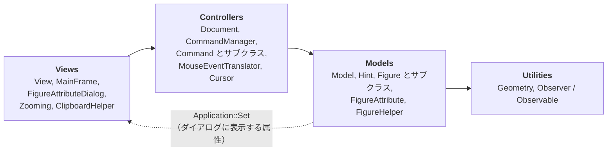

| 名前空間 | 内容 |
|---|---|
| `Shos::MiniCadSample` | `Application` |
| `Shos::MiniCadSample::Models` | 図形、属性、`Model`、`Hint` |
| `Shos::MiniCadSample::Views` | `View`、`MainFrame`、属性ダイアログ、ズーム、クリップボード |
| `Shos::MiniCadSample::Controllers` | `Document`、コマンド、マウス入力 |
| `Shos::MiniCadSample::Utilities` | 幾何計算、Observer |
| `Shos::MFCDoubleBuffer` | ダブルバッファリング ライブラリ（アプリから独立） |
| `shos` | Undo/Redo コンテナー（アプリから独立、STL 風の命名） |

ここでは MFC の `CDocument` を**コントローラー**として使っています。`Model` と `CommandManager` を所有し、マウスイベントを受け取り、モデルからの通知をビューに転送します。データそのものは `Model` にあり、`Model` はビューを一切呼ばないので、ウィンドウなしで単体テストできます（メインウィンドウがないとき、たとえばテスト中は、`Application::Set` は何もしません）。

<a id="objects"></a>

### 実行時のオブジェクト

次のクラス図は、実行中のアプリケーションの主なオブジェクトと、どれがどれを所有しているかを示します。黒いひし形は「（メンバーとして、または `unique_ptr` で）所有する」、点線の矢印は「使う / 送る」を表します。

```mermaid
classDiagram
    direction LR
    class Application {
        CWinApp
        +Set(FigureAttribute)$
        +SetFigureAttributeObserver(observer)$
    }
    class MainFrame {
        CFrameWnd
        WM_SET_FIGURE_ATTRIBUTE
        WM_SET_FIGURE_ATTRIBUTE_OBSERVER
    }
    class FigureAttributeDialog {
        CDialogEx
        モードレス
    }
    class Document {
        CDocument
        +OnDragStart() ...
        #Update(Hint)
        +Paste(CArchive)
    }
    class View {
        DoubleBufferView
        +OnDrawLayer1(CDC)
        +OnDrawLayer2(CDC)
        +OnUpdate(...)
    }
    class MouseEventTranslator
    class Zooming
    class Model {
        +Add(figure)
        +Update(change)
        +Select(...)
        +Undo() / Redo()
        +Paste(CArchive)
    }
    class CommandManager {
        +SetCommand(command)
    }
    class Command {
        現在のツール
    }
    class Figures["undo_redo_pointer_vector of Figure"]
    class Figure

    Application ..> MainFrame : SendMessage
    Model ..> Application : Set(attribute)
    View ..> Application : SetFigureAttributeObserver(model)
    MainFrame *-- FigureAttributeDialog
    View *-- MouseEventTranslator
    View *-- Zooming
    View ..> Document : GetDocument()
    MouseEventTranslator ..> Document : マウスイベント
    MouseEventTranslator ..> View : マウスイベント（パン）
    Document *-- Model
    Document *-- CommandManager
    CommandManager *-- "1" Command : unique_ptr
    Command ..> Model : 変更
    Model *-- Figures
    Figures *-- "*" Figure : 所有し、削除する
```

- `MainFrame`、`Document`、`View` は、MFC が SDI のドキュメント テンプレート（`Application::InitInstance`）を通じて作ります。SDI では、File > New / Open のときも同じドキュメントとビューのオブジェクトが**再利用**されます。
- ダイアログを知っているのは `MainFrame` だけです。`Model`（選択した図形の属性を表示するため）と `View::OnInitialUpdate`（モデルをダイアログのオブザーバーとして登録するため）は、`Application` の static 関数を通じてダイアログに届きます。これらの関数は `MainFrame` に独自のメッセージを送ります。メインウィンドウがないとき（起動中、終了中、単体テスト中など）は何もしません。

### クラス階層

#### 図形（`Figure.h`）

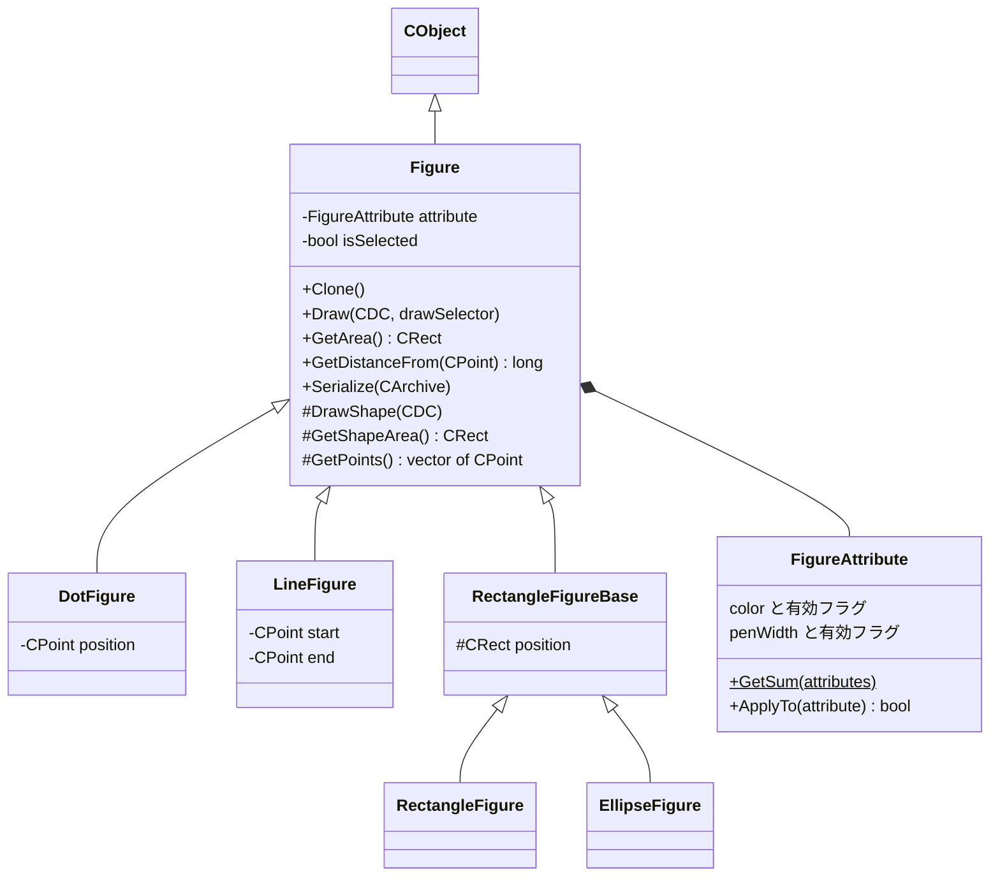

これは **Template Method** パターンです。`Figure::Draw` がペン（色・太さ）と中空ブラシを選択し、仮想関数 `DrawShape` を呼び、最後に `GetPoints()` の位置に選択マーカーを描きます。サブクラスは、自分の形が*何か*を示すだけです。どのクラスにも `DECLARE_SERIAL` / `IMPLEMENT_SERIAL` があるので、`CArchive` は `Figure*` をポリモーフィックに書き込み、読み込めます。

#### コマンド（`Command.h`）

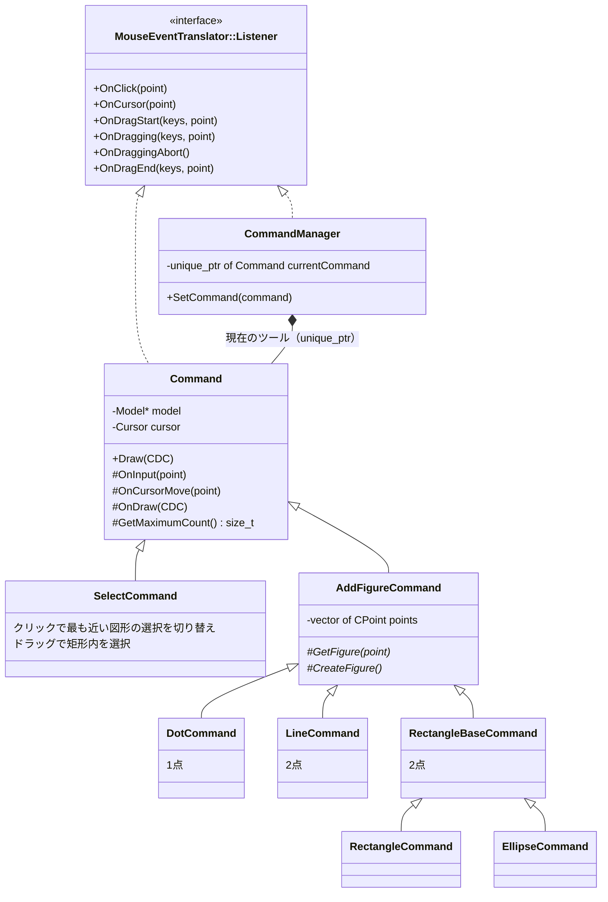

（Mermaid のクラス図では、メソッドの後ろの `*` は抽象、`$` は static を表します。）

`Command` は、6種類のマウスイベントを3つの単純なフックに変換します。`OnInput`（点が入力された）、`OnCursorMove`、`OnDraw`（ラバーバンド）です。2点を取るツールでは、既定でドラッグを2回の入力（開始と終了）として扱います。そのため、どのツールも追加のコードなしで、クリック入力とドラッグ入力の両方に対応しています。`CommandManager` 自身も `Listener` で、各イベントを現在のコマンドに転送します。

#### ビューとダブルバッファリング ライブラリ（`DoubleBuffer.h`、`View.h`）

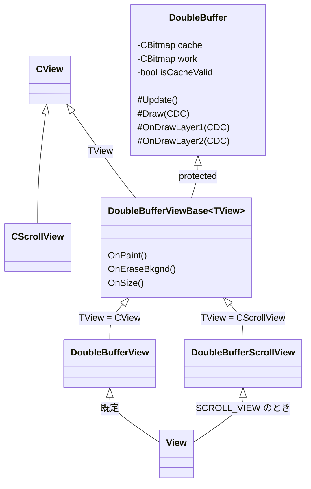

`DoubleBufferViewBase` は MFC のビュークラスを型引数に取るクラス テンプレートなので、1つの実装で `CView` と `CScrollView` の両方に対応できます。MFC のメッセージマップはテンプレートにできないので、ハンドラーはテンプレートに置き、具象クラス（`DoubleBufferView`、`DoubleBufferScrollView`）ごとのメッセージマップを `DoubleBuffer.cpp` に置いています。

### Observer の接続

独立した2つの Observer の経路が各部分をつないでいます。`Observable<THint>` / `Observer<THint>`（`Observer.h`）は小さなテンプレートの組で、ヒントの型によって経路ごとに型安全になっています。

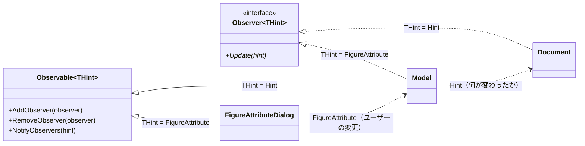

| 経路 | Observable | Observer | ヒント |
|---|---|---|---|
| モデルの変更 | `Model` | `Document`（`UpdateAllViews` を呼ぶ） | `Hint`: `Added` / `Removed` / `Changed` / `All` / `ViewOnly` と対象の図形 |
| 属性の編集 | `FigureAttributeDialog` | `Model` | 編集した項目だけが有効な `FigureAttribute` |

<a id="walkthroughs"></a>

## 処理の流れ

<a id="walkthrough-1"></a>

### 1. 図形を描く（入力からモデルへ）

#### マウスメッセージからコマンドまで

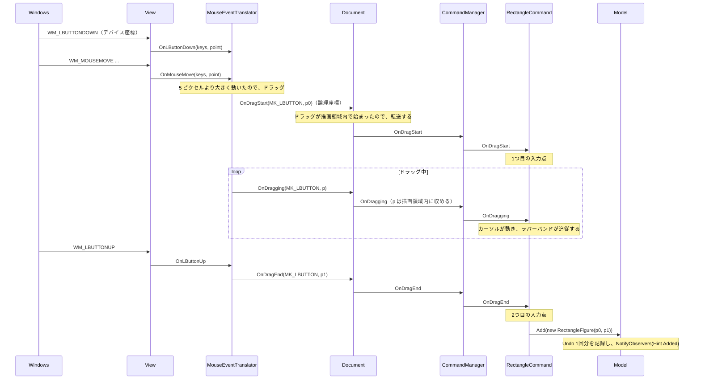

1. `View` は、生のマウスメッセージを `MouseEventTranslator` に渡します。
2. `MouseEventTranslator` は、押下がクリックかドラッグかを判定し、デバイス座標の点を論理座標に変換します（`Geometry::DPtoLP`。ビューの `OnPrepareDC` を使います）。
3. `Document` は、ドラッグが描画領域の中で始まったことを確かめてから、`CommandManager` に転送します。ドラッグ中の点は描画領域内に収められるので、コマンドは必ずドラッグ終了を受け取ります。
4. `CommandManager` は、現在の `Command` に転送します。`AddFigureCommand` は点を集めて図形を作り、`Model::Add` を呼びます。

ツールを追加するには、`Command` のサブクラスを新しく書きます。入力の経路のほかの部分は変わりません。

#### `MouseEventTranslator` がクリックとドラッグを見分ける仕組み

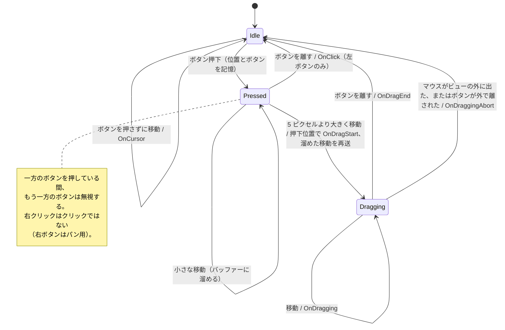

リスナーから見ると、ドラッグはドラッグと判定された位置ではなく、ボタンが**押された**位置から始まります。溜めておいた移動は再送されるので、軌跡が欠けることはありません。

#### `AddFigureCommand` が点を集める仕組み（クリック入力）

クリック入力とドラッグ入力は、この処理を共有しています。ドラッグの開始と終了が2回の入力になります。図は2点のツール（線分・矩形・楕円）の場合です。点のツールは1回のクリックで済みます。

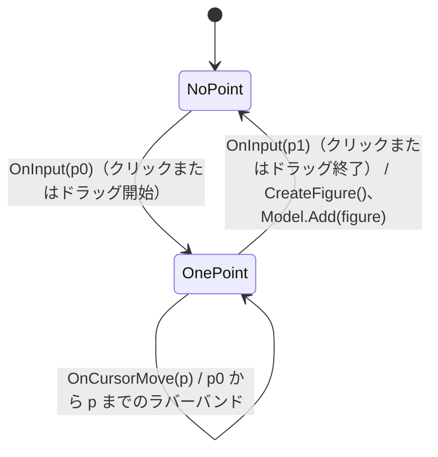

2つ目の点を待っている間、コマンドは現在の属性で、`p0` からカーソルまでの**プレビュー図形**（`GetFigure`）を描きます。プレビューはコマンドのメンバーで、描画のたびに描き直されます（layer 2）。最終的な図形（`CreateFigure`）は `new` で確保されてモデルに渡され、それ以降はモデルが所有します。

<a id="walkthrough-2"></a>

### 2. モデルが変わる（モデルから画面へ）

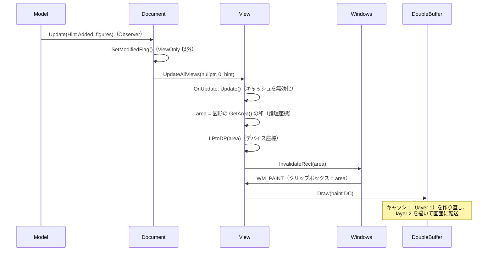

- `Model` への変更（と選択の変更）は、必ず `NotifyObservers(Hint(...))` で終わります。ヒントの種類によって、ビューがどこまで描き直すかが決まります。

  | ヒントの種類 | 送る操作 | ビューが描き直す範囲 | 変更フラグ |
  |---|---|---|---|
  | `Added` | `Add`、`Paste`、Random | 追加した図形の範囲 | 立てる |
  | `Removed` | `RemoveSelectedFigures` | 削除した図形の範囲 | 立てる |
  | `Changed` | 属性の変更 | 変更前**と**変更後の図形の範囲（線が太くなると図形も大きくなるため） | 立てる |
  | `All` | `Undo`、`Redo`、ファイルの読み込み | 全体 | 立てる |
  | `ViewOnly` | 選択の変更、新しい図形の属性、`Reset`（File > New / Open の前に `DeleteContents` から呼ばれる）、`Paste`（`Added` の後、選択の表示のため） | 全体 | 立てない |

- モデルがビューを直接呼ぶことはありません。だから `Model` はウィンドウなしでテストできます。
- 選択ツールの強調表示はモデルの変更ではありません。`Model::Highlight` は図形を覚えるだけで、再描画されるのは `View::OnMouseMove` がマウスの移動のたびにウィンドウを無効化するからです。

<a id="walkthrough-3"></a>

### 3. 図形を選択する

選択ツールでクリックすると、最も近い図形の選択が切り替わります。その後、ダイアログに選択した図形の属性が表示されます。

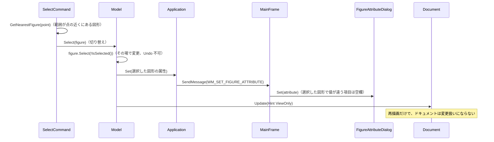

ダイアログに送る属性は、選択の状態によって変わります（`Model::GetAttribute`）。1つ選択ならその図形の属性、複数ならそれらをまとめた属性（`FigureAttribute::GetSum`）、選択なしなら新しい図形用の属性です。

`GetNearestFigure` は、まず、範囲（`GetArea()`。外接矩形を、線の太さとマーカーの分だけ広げたもの）が、点から上下左右に 100 論理単位ずつ広げた正方形と重ならない図形を除外します。残りの中から `GetDistanceFrom` が最小の図形を選びます。カーソルが動いている間、`SelectCommand` はその図形を強調表示し（外接矩形を描きます）、カーソルの横に距離を表示します（スクリーンショットを参照）。ドラッグすると、範囲がドラッグした矩形の中に完全に入る図形をすべて選択し、それ以外の選択を外します。ドラッグ中の矩形は XOR のペンで描かれます。

<a id="walkthrough-4"></a>

### 4. Undo / Redo

`Model` は図形を `shos::undo_redo_pointer_vector<Figure>`（`undo_redo_vector.h`）に保持しています。

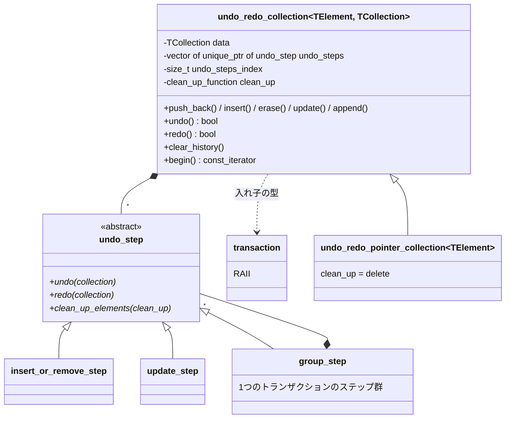

変更はそれぞれ、自分自身を元に戻したり、やり直したりできる **Undo ステップ**として記録されます（データの層での Command パターンです）。`undo_steps_index` が、実行済みのステップと、取り消した（Redo できる）ステップの境目を示します。

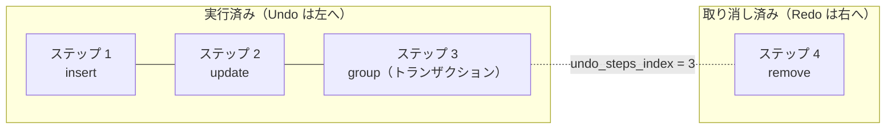

Undo の後に新しい変更をすると、Redo の部分（この図ではステップ 4）は捨てられます。そのときに初めて、それらのステップだけが持っていた図形が削除されます。

図形の変更が Undo できるようになる仕組み（`Model::Update`。ダイアログでユーザーが属性を編集したときに呼ばれます）:

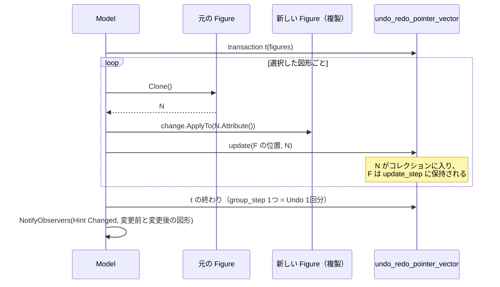

この設計から、次の決まりが出てきます。

- **要素は読み取り専用です。** イテレーターは常に `const_iterator` です。図形を変えるには、`Clone()` して、複製を編集し、その位置を `update` します（`Model::Update` を参照）。元の図形は履歴に残るので、Undo で元に戻せます。（選択だけは例外で、図形をその場で変更し、Undo できません。）
- **トランザクション。** RAII の `transaction` オブジェクトで、複数のステップを1回分の Undo にまとめます。たとえば、選択した5つの図形の削除です。トランザクションは入れ子にでき、ステップを作るのは一番外側のものだけです。トランザクションの最中は、`undo()` / `redo()` は `false` を返します。
- **所有権。** コンテナーはポインターを所有し、各図形を、二度と戻れなくなった時点でちょうど1回だけ削除します。その時点とは、Redo の履歴が捨てられたとき、履歴を消したとき（`clear_history()`。ファイルの読み込み後など）、`reset()` のとき、コンテナーが破棄されたときです。`Figure*` をモデルに渡した後は、自分で削除してはいけません。
- **例外安全性。** `push_back`、`insert`、`update` が例外を投げても、コレクションとその履歴は変わらず、渡した要素は後始末されています。`std::vector` を使う場合、`undo()` / `redo()` はメモリを確保しません。要素の型は、例外を投げずにムーブとスワップができる必要があります（`undo_redo_element` コンセプト）。

このコンテナーは MFC からもこのアプリケーションからも独立しているので、再利用できます。

<a id="walkthrough-5"></a>

### 5. ちらつかない描画

`View` は `DoubleBuffer.h` の `DoubleBufferView`（または `DoubleBufferScrollView`）から派生しており、`OnDraw` ではなく2つの層に分けて描きます。

| 層 | 内容 | 描かれるとき |
|---|---|---|
| `OnDrawLayer1` | 描画領域と図形 | クライアント領域と同じ大きさのキャッシュ用ビットマップに、`Update()` で無効化された後だけ描く |
| `OnDrawLayer2` | 現在のツールのラバーバンドとカーソル | `WM_PAINT` のたびに、キャッシュの上に描く |

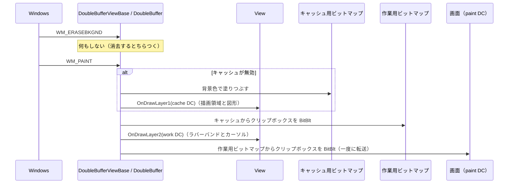

マウスを動かすとウィンドウ全体が無効化されます（`View::OnMouseMove`）が、図形が描き直されることはありません。1回の描画は、キャッシュからの `BitBlt` 2回と layer 2 だけです。そのため、図形が多くても速く、ちらつきません。モデルが変わったときは対象の図形の範囲だけが無効化されるので、そのクリップボックスだけが処理されます。2つのビットマップは、クライアント領域の大きさが変わったときだけ作り直されます。作れなかったとき（メモリ不足など）は、画面に直接描きます。ちらつくことはありますが、表示は正しいままです。

<a id="walkthrough-6"></a>

### 6. 座標、ズーム、パン

- **論理座標**はモデルの座標です。描画領域は 2000 × 2000 です。図形、コマンド、当たり判定はすべて論理座標を使います。
- **デバイス座標**はクライアント領域のピクセルです。マウスメッセージと `InvalidateRect` はデバイス座標を使います。
- 両者の対応は `View::OnPrepareDC` で設定します。`ZOOMING_VIEW`（既定）では、`Zooming` が描画領域のうち表示する部分（`logicalArea`）を、縦横比を保ったまま（`MM_ISOTROPIC`）クライアント領域全体に対応させます。

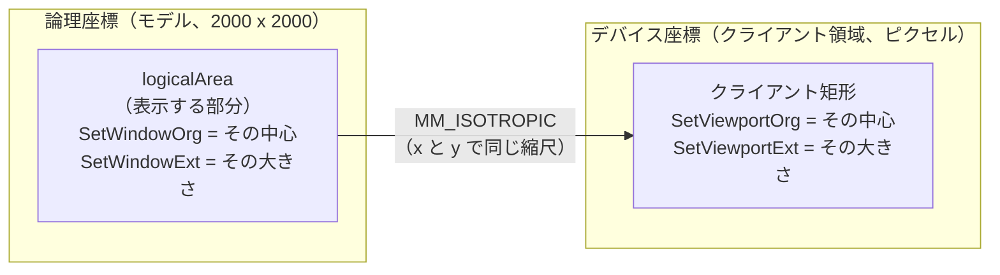

ズームで変わるのは `logicalArea` だけです。

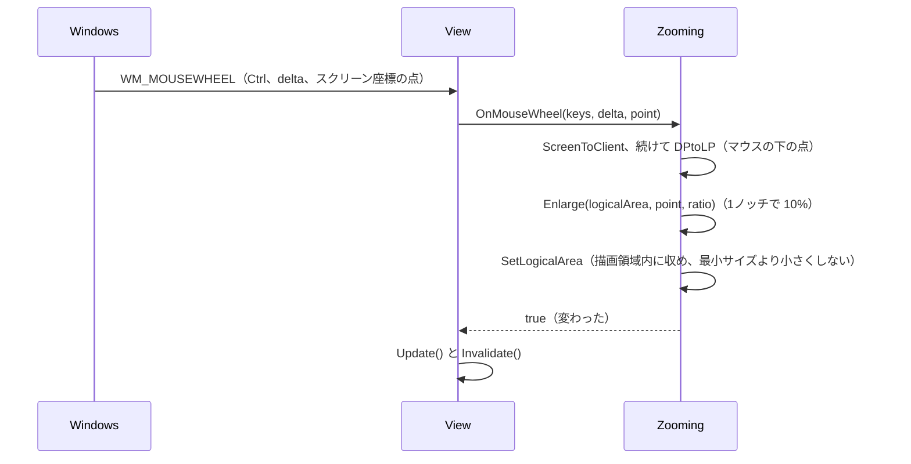

パン（右ボタンでのドラッグ）は、マウスの下の点がマウスに付いてくるように `logicalArea` を動かします。十字のカーソルとその横のメッセージ文字列は、描くときにデバイス単位から論理単位に変換される（`Command.h` の `Cursor`）ので、ズームしても画面上の大きさは変わりません。図形は線の太さや選択マーカーも含めて論理単位なので、ズームに合わせて拡大縮小されます。

ビューの種類は、`View.h` の先頭のマクロで切り替えられます。定義するのはどちらか一方だけです。スクロールビューを使うには、`#define ZOOMING_VIEW` をコメントアウトし、`#define SCROLL_VIEW` のコメントを外します。

| マクロ | 基底クラス | 動作 |
|---|---|---|
| `ZOOMING_VIEW`（既定） | `DoubleBufferView` | `Ctrl` + ホイールでズーム、右ドラッグでパン |
| `SCROLL_VIEW` | `DoubleBufferScrollView` | スクロールバー、`MM_TEXT`、ズームなし |
| どちらもなし | `DoubleBufferView` | 描画領域全体が常にウィンドウに収まる |

<a id="walkthrough-7"></a>

### 7. クリップボードとシリアライズ

**コピー**（`ClipboardHelper.h`）では、3つの形式を一度にクリップボードに置きます。そのため、どんな種類のアプリケーションでも何かしらを受け取れます。

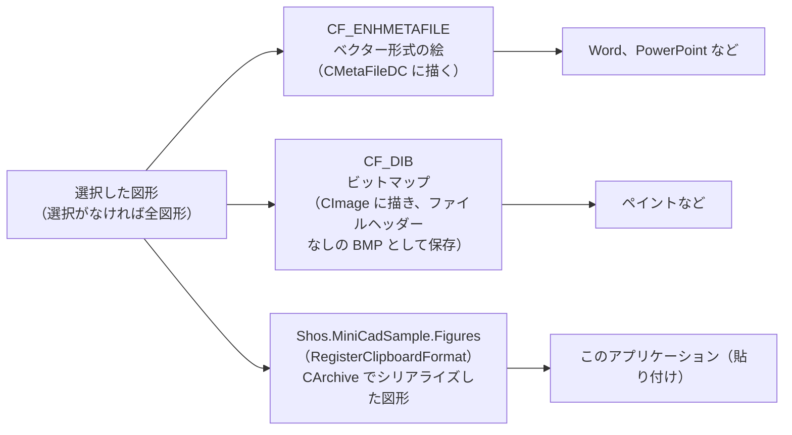

**貼り付け**ではカスタム形式を読み込みます。`Model::Paste` は「全部成功か、何もしないか」のどちらかです。

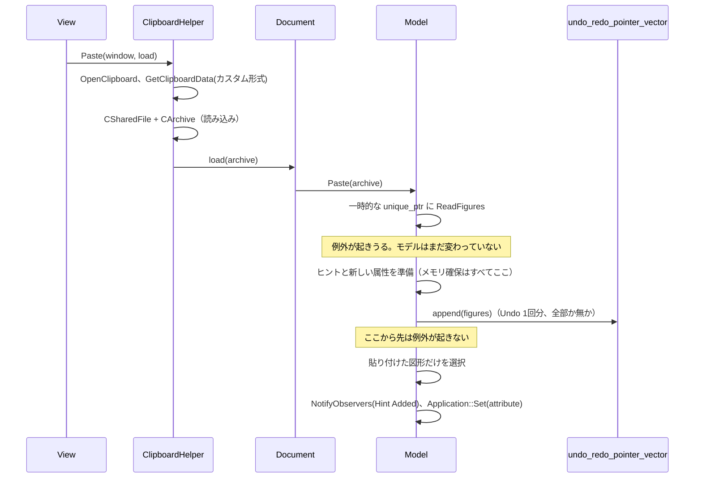

そのため、クリップボードの内容が壊れていても、モデルは変わらず、リークも起きません。テストでは、メモリ確保を1回ずつ順番に失敗させて、このことを確かめています。**切り取り**はコピーの後に `RemoveSelectedFigures` を行うものなので、これも Undo できます。コピーと違い、図形が選択されているときだけ有効です。

**ファイル**も同じシリアライズを使います（`Model::Serialize`）。図形の数に続けて、図形ごとに `ar.WriteObject(figure)` を書きます。`CArchive` は各クラスが最初に現れたときにクラス名を書き込み、読み込むときは `IMPLEMENT_SERIAL` によって正しいサブクラスを作り直します。読み込んだ後は Undo の履歴を消します。ファイルとクリップボードのデータには名前空間なしのクラス名（`"RectangleFigure"`）が保存されるので、C++ の名前空間はデータ形式に影響しません。

<a id="walkthrough-8"></a>

### 8. モードレスの属性ダイアログ

`FigureAttribute` は色と線の太さを持ち、それぞれに*有効*フラグがあります。ダイアログには、選択した図形の属性をまとめたもの（`GetSum`）が表示されます。図形によって値が違う項目は無効になり、空欄で表示されます。

1つの項目を編集すると、ダイアログはその項目だけが有効な*変更*を送ります。

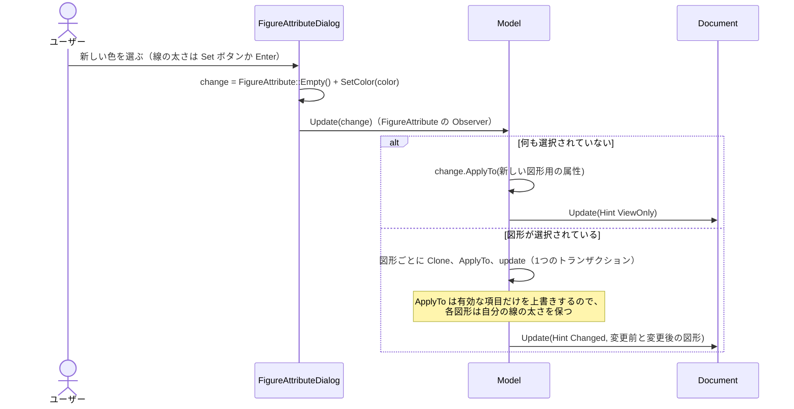

すでに新しい値を持っている図形は置き換えないので、Undo のステップにも加わりません。ダイアログはモデルを知りません。`View` が `Application::SetFigureAttributeObserver` を通じて、モデルをダイアログのオブザーバーとして登録しています。

<a id="reading-order"></a>

## おすすめの読む順番

1. `Observer.h`、`Geometry.h`: あちこちで使われる小さなユーティリティ。
2. `FigureAttribute.h`、`Figure.h`: データ。`Clone()` とシリアライズに注目してください。
3. `Model.h`: 図形の追加・変更・選択・Undo・貼り付けの方法と、変更の通知のしかた。
4. `undo_redo_vector.h`: Undo/Redo を支えるコンテナー。まず冒頭の概要コメントを読んでください。
5. `MouseEventTranslator.h`、`Command.h`、`Document.h`: マウスからモデルまでの入力の経路。
6. `DoubleBuffer.h`、`Zooming.h`、`View.h`: 描画、座標、ビュー。
7. `ClipboardHelper.h`、`FigureAttributeDialog.h`、`MainFrame.h`、`Application.h`: 残りの UI。
8. テスト: `ModelTest.cpp`、`MouseEventTranslatorTest.cpp`、`Shos.MiniCadSample.Test.cpp` に、例外安全性の検査も含めて、意図した動作が示されています。

<a id="exercises"></a>

## 演習

- **新しい種類の図形を追加する**（角丸矩形や折れ線など）:
  1. `Figure.h` に `Figure` のサブクラスを追加します。`Clone`、`DrawShape`、`GetShapeArea` / `GetDistanceFrom`、`Serialize` を実装し、`DECLARE_SERIAL` を付けます。
  2. `Figure.cpp` に `IMPLEMENT_SERIAL` を追加します。
  3. `Command.h` に `Command` のサブクラスを追加します。
  4. `Document.h` / `Document.cpp` にメニュー項目とハンドラーを追加します。
- **選択を Undo できるようにする。** ヒント: 現在、選択は図形をその場で変更しています。
- **選択した図形をドラッグで移動する**（選択ツールで、1回のドラッグを1回分の Undo にする）。
- **追加した図形だけをキャッシュに描く。** 追加のたびにキャッシュ全体を作り直す代わりに、`DoubleBuffer::CacheDevice` を使います。

## レポジトリの構成

```
Shos.MiniCadSample/                 アプリケーション本体
Shos.MiniCadSample.Test/            単体テスト
Shos.MiniCadSample.MemoryLeakTest/  Undo/Redo コンテナーのメモリリーク検査
Documents/images/                   スクリーンショット
Reviews/, Plans/                    設計レビューと修正計画（日本語）
CLAUDE.md                           アーキテクチャと規約のメモ
```

## ライセンス

[MIT License](LICENSE.txt)
