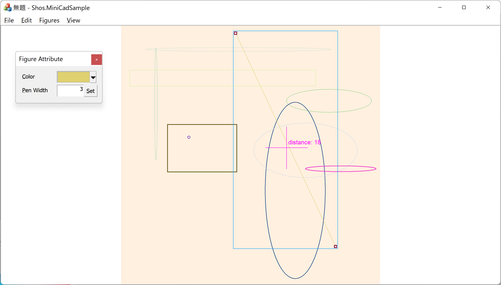

# [C++/MFC] Shos.MiniCadSample



Sample of simple CAD.

* Functions
    * Figures
        * Dot
        * Line segment
        * Rectangle
        * Ellipse
        * Random
    * Command
        * Figure selection
            * Single Figure selection
            * Multi Figure selection
        * Command switching
        * Dragging input and Clicking input
        * Undo / Redo
        * Rubberband
    * View
        * Double Buffering
        * Scroll View
        * View to fit window size
        * Zoom View
    * Modeless Dialog
    * Serialization
    * Clipboard operation
        * Copy to:
          Extended metafiles, bitmaps, and custom format
        * Paste from:
          Custom format
    * class design
        * Separation of model and view
        * Notification by Observer Pattern

* Development & Execution Environment
    * Language: C++20
    * Framework: MFC
    * OS: Windows
    * IDE: Visual Studio 2026 (platform toolset v145)

## Build

Open `Shos.MiniCadSample.sln` in Visual Studio and build. The configurations are `Debug` / `Release` × `x86` / `x64`.

From a Developer PowerShell:

```powershell
msbuild Shos.MiniCadSample.sln /p:Configuration=Debug /p:Platform=x64
```

## Test

* `Shos.MiniCadSample.Test`: unit tests (Microsoft C++ Unit Test Framework). Run them from the Test Explorer of Visual Studio, or:

  ```powershell
  vstest.console.exe x64\Debug\Shos.MiniCadSample.Test.dll
  ```

* `Shos.MiniCadSample.MemoryLeakTest`: memory leak check of the undo / redo collection (`Debug` builds only). The exit code is 0 if there is no leak, 1 if there are leaks (dumped to stderr).

  ```powershell
  x64\Debug\Shos.MiniCadSample.MemoryLeakTest.exe
  ```
