# [C++/MFC] Shos.MiniCadSample

English | [日本語](README.jp.md)


A small 2D CAD application written in **C++20 and MFC**. It draws dots, lines, rectangles and ellipses, and supports selection, undo/redo, zooming and panning, file save/load and clipboard copy/paste.

The application is small on purpose. It is a **teaching sample** for intermediate C++ / MFC / Win32 programmers: each feature shows a design idea or Windows technique in readable code. Every source file is commented in English, and most of the logic is in headers, so you can read a feature from start to end in one or two files.

This README explains the design with diagrams: class diagrams for the structure, sequence diagrams for "what happens when...", and state diagrams for the input logic. GitHub renders them. In other viewers, use one that supports [Mermaid](https://mermaid.js.org/).

## Contents

- [What you can learn from this sample](#what-you-can-learn-from-this-sample)
- [Using the application](#using-the-application)
- [Requirements, build and test](#requirements-build-and-test)
- [Architecture](#architecture): layers, objects at run time, class hierarchies, Observer connections
- [Walkthroughs](#walkthroughs)
  1. [Drawing a figure (input to model)](#1-drawing-a-figure-input-to-model)
  2. [The model changes (model to screen)](#2-the-model-changes-model-to-screen)
  3. [Selecting figures](#3-selecting-figures)
  4. [Undo / redo](#4-undo--redo)
  5. [Flicker-free drawing](#5-flicker-free-drawing)
  6. [Coordinates, zooming and panning](#6-coordinates-zooming-and-panning)
  7. [Clipboard and serialization](#7-clipboard-and-serialization)
  8. [The modeless attribute dialog](#8-the-modeless-attribute-dialog)
- [Suggested reading order](#suggested-reading-order)
- [Exercises](#exercises)

## What you can learn from this sample

| Topic | What the sample shows | Where to look |
|---|---|---|
| **Model / view separation** | The model never calls a view. It notifies changes through a small, type-safe Observer template, and passes a *hint* that says which figures changed. | `Observer.h`, `Model.h` (`Hint`), `Document.h`, `View.h` (`OnUpdate`) |
| **Command pattern for tools** | Each tool (Select, Dot, Line, Rectangle, Ellipse) is a `Command` object that handles input and draws its own rubber band. Switching tools means replacing one object. | `Command.h` |
| **Mouse input as events** | Raw `WM_LBUTTONDOWN` / `WM_MOUSEMOVE` / ... messages are turned into *click*, *cursor move*, *drag start / dragging / drag end / drag abort*. Commands never see raw messages. | `MouseEventTranslator.h` |
| **Undo / redo** | A generic, exception-safe undo/redo container (STL style, with transactions) owns the figures. A change replaces a figure with an edited clone, and that is what makes it undoable. | `undo_redo_vector.h`, `Model.h` |
| **Flicker-free drawing** | A reusable double-buffering library with two layers: a cached bitmap for the figures, and a layer that is redrawn on every paint for the rubber band and cursor. | `DoubleBuffer.h` |
| **Coordinate systems** | Logical (model) and device (pixel) coordinates, `MM_ISOTROPIC` mapping, zooming around the mouse position, and panning. | `Zooming.h`, `Geometry.h`, `View.h` |
| **Clipboard** | Copy in three formats at once: enhanced metafile, DIB, and a registered custom format. Paste is all-or-nothing and undoable. | `ClipboardHelper.h`, `Model.h` (`Paste`) |
| **Serialization** | `CObject` / `CArchive` / `IMPLEMENT_SERIAL` for polymorphic figures, used for both files and the clipboard. | `Figure.h`, `Figure.cpp`, `Model.h` (`Serialize`) |
| **Modeless dialog** | A tool window that shows the attribute of the selection and sends *changes* back. Only the items you edit are applied. | `FigureAttributeDialog.h`, `FigureAttribute.h`, `MainFrame.h` |
| **Modern C++ in MFC** | C++20 concepts, ranges, `std::unique_ptr`, RAII helpers (`GdiObjectSelector`), namespaces by layer, `constexpr`, designated initializers. | everywhere |
| **Testing an MFC app** | Unit tests for the model, geometry, input translation and the undo container, including tests that make the N-th `new` throw, to check exception safety and leaks. | `Shos.MiniCadSample.Test`, `Shos.MiniCadSample.MemoryLeakTest` |

## Using the application

When the application starts, the **Select** tool is active. The beige rectangle is the drawing area (the model). Input outside it is ignored.

| Action | How |
|---|---|
| Choose a tool | **Figures** menu: Dot, Line, Rectangle, Ellipse, Select (`Ctrl+Q`) |
| Draw a figure | Two-point tools (Line, Rectangle, Ellipse): **click twice**, or **drag** with the left button. Dot: **one click**. A rubber band shows the figure while you draw it. |
| Select | Select tool: **click** near a figure to toggle its selection. Clicking toggles one figure at a time, so you can select several. **Drag** a rectangle to select the figures that are completely inside it (the others are deselected). Clicking far from every figure clears the selection. The nearest figure is highlighted with its bounding rectangle, and the cursor shows its distance. |
| Change color / pen width | **View > Figure Attribute Dialog**. A color applies as soon as you pick it; a pen width applies when you press **Set** or `Enter`. With a selection, the edit applies to the selected figures (as one undo step). Without one, it sets the attribute for new figures. |
| Delete | `Del` |
| Undo / Redo | `Ctrl+Z` / `Ctrl+Y` |
| Cut / Copy / Paste | `Ctrl+X` / `Ctrl+C` / `Ctrl+V`. Copy takes the selected figures, or all figures if none is selected. Cut needs a selection. Paste into another application (e.g. Word or Paint) to get the picture. |
| Zoom | `Ctrl` + mouse wheel. Zooms around the mouse position. |
| Pan | Drag with the **right** button |
| Add sample data | **Figures > Random** adds 10 random figures |
| Save / Open | **File** menu, `Ctrl+S` / `Ctrl+O` (MFC serialization) |

## Requirements, build and test

- Windows, Visual Studio 2026 with the **Desktop development with C++** workload and **MFC** (platform toolset v145)
- C++20

Open `Shos.MiniCadSample.sln` in Visual Studio and build. The configurations are `Debug` / `Release` × `x86` / `x64`.

From a Developer PowerShell:

```powershell
msbuild Shos.MiniCadSample.sln /p:Configuration=Debug /p:Platform=x64

# Unit tests (or use the Test Explorer in Visual Studio)
vstest.console.exe x64\Debug\Shos.MiniCadSample.Test.dll

# Memory leak check (Debug only). Exit code 0 = no leak, 1 = leaks (dumped to stderr)
x64\Debug\Shos.MiniCadSample.MemoryLeakTest.exe
```

The solution has three projects:

| Project | Contents |
|---|---|
| `Shos.MiniCadSample` | The MFC application (SDI, MFC as a shared DLL, precompiled header `pch.h`) |
| `Shos.MiniCadSample.Test` | Unit tests (Microsoft C++ Unit Test Framework). They test the model, figure attributes, geometry, `MouseEventTranslator`, `Observer` and the undo/redo container. |
| `Shos.MiniCadSample.MemoryLeakTest` | A console program that runs undo/redo scenarios and reports leaks with the CRT debug heap |

## Architecture

### Layers and namespaces

Dependencies go mainly one way: Views → Controllers → Models → Utilities. Each layer has its own namespace. There is one deliberate shortcut: `Model` pushes the selection's attribute to the attribute dialog through the static `Application::Set` (see [Objects at run time](#objects-at-run-time)).

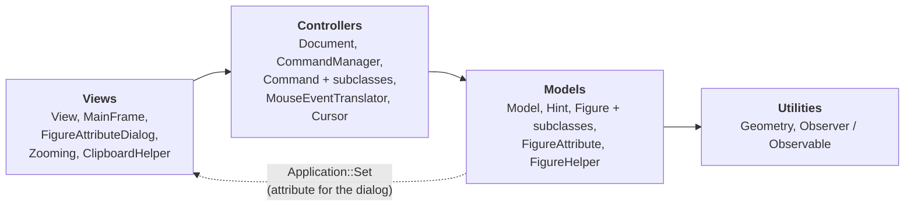

| Namespace | Contents |
|---|---|
| `Shos::MiniCadSample` | `Application` |
| `Shos::MiniCadSample::Models` | figures, attributes, `Model`, `Hint` |
| `Shos::MiniCadSample::Views` | `View`, `MainFrame`, the attribute dialog, zooming, clipboard |
| `Shos::MiniCadSample::Controllers` | `Document`, commands, mouse input |
| `Shos::MiniCadSample::Utilities` | geometry, Observer |
| `Shos::MFCDoubleBuffer` | the double-buffering library (independent of the app) |
| `shos` | the undo/redo container (independent of the app, STL naming) |

MFC's `CDocument` is used here as a **controller**. It owns the `Model` and the `CommandManager`, receives mouse events and forwards model notifications to the views. The data itself is in `Model`, which never calls a view, so it can be unit-tested without a window. (`Application::Set` does nothing when there is no main window, as in the tests.)

### Objects at run time

The class diagram below shows the main objects of the running application and who owns whom. A filled diamond means "owns (as a member or via `unique_ptr`)"; a dashed arrow means "uses / sends to".

```mermaid
classDiagram
    direction LR
    class Application {
        CWinApp
        +Set(FigureAttribute)$
        +SetFigureAttributeObserver(observer)$
    }
    class MainFrame {
        CFrameWnd
        WM_SET_FIGURE_ATTRIBUTE
        WM_SET_FIGURE_ATTRIBUTE_OBSERVER
    }
    class FigureAttributeDialog {
        CDialogEx
        modeless
    }
    class Document {
        CDocument
        +OnDragStart() ...
        #Update(Hint)
        +Paste(CArchive)
    }
    class View {
        DoubleBufferView
        +OnDrawLayer1(CDC)
        +OnDrawLayer2(CDC)
        +OnUpdate(...)
    }
    class MouseEventTranslator
    class Zooming
    class Model {
        +Add(figure)
        +Update(change)
        +Select(...)
        +Undo() / Redo()
        +Paste(CArchive)
    }
    class CommandManager {
        +SetCommand(command)
    }
    class Command {
        current tool
    }
    class Figures["undo_redo_pointer_vector of Figure"]
    class Figure

    Application ..> MainFrame : SendMessage
    Model ..> Application : Set(attribute)
    View ..> Application : SetFigureAttributeObserver(model)
    MainFrame *-- FigureAttributeDialog
    View *-- MouseEventTranslator
    View *-- Zooming
    View ..> Document : GetDocument()
    MouseEventTranslator ..> Document : mouse events
    MouseEventTranslator ..> View : mouse events (panning)
    Document *-- Model
    Document *-- CommandManager
    CommandManager *-- "1" Command : unique_ptr
    Command ..> Model : changes
    Model *-- Figures
    Figures *-- "*" Figure : owns and deletes
```

- MFC creates `MainFrame`, `Document` and `View` through the SDI document template (`Application::InitInstance`). In SDI, the same document and view objects are **reused** for File > New / Open.
- Nobody but `MainFrame` knows the dialog. `Model` (to show the selection's attribute) and `View::OnInitialUpdate` (to register the model as the dialog's observer) reach it through the static functions of `Application`, which send private messages to `MainFrame`. Those functions do nothing when the main window does not exist, for example at startup, at shutdown and in the unit tests.

### Class hierarchies

#### Figures (`Figure.h`)

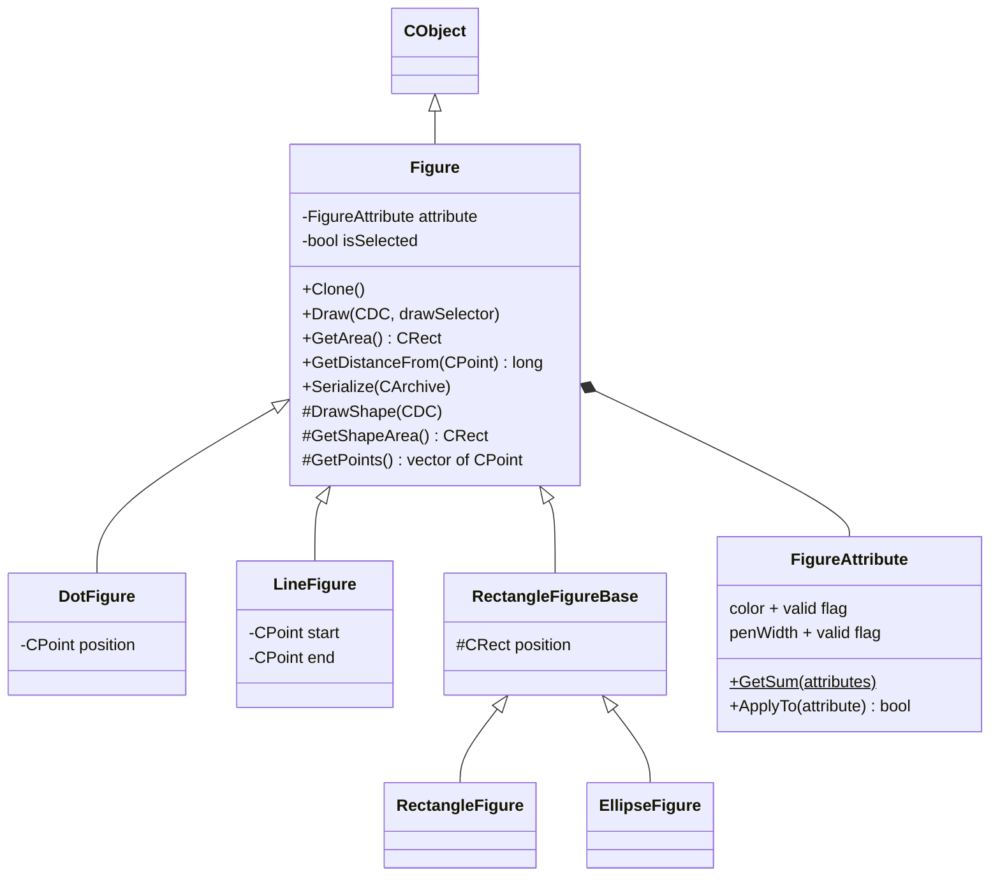

This is the **Template Method** pattern. `Figure::Draw` selects the pen (color, width) and a null brush, calls the virtual `DrawShape`, and then draws the selection markers at `GetPoints()`. A subclass only says *what* its shape is. Every class has `DECLARE_SERIAL` / `IMPLEMENT_SERIAL`, so `CArchive` can write and read a `Figure*` polymorphically.

#### Commands (`Command.h`)

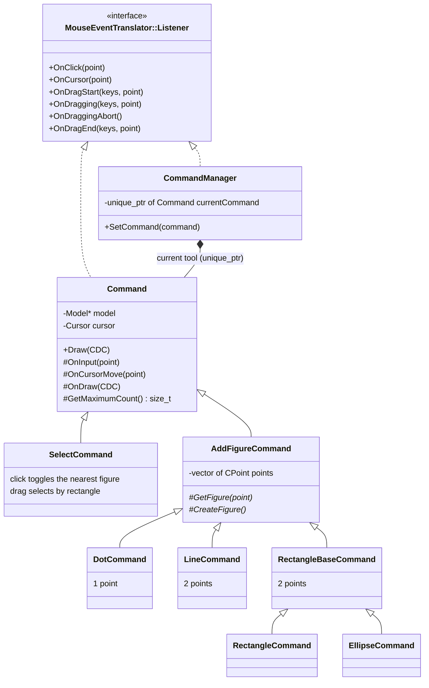

(In Mermaid class diagrams, `*` after a method marks it abstract and `$` marks it static.)

`Command` turns the six mouse events into three simple hooks: `OnInput` (a point was entered), `OnCursorMove` and `OnDraw` (the rubber band). By default a drag counts as two inputs, its start and its end, for a tool that takes two points. That is why every tool supports both click input and drag input with no extra code. `CommandManager` is itself a `Listener`: it forwards each event to the current command.

#### Views and the double-buffering library (`DoubleBuffer.h`, `View.h`)

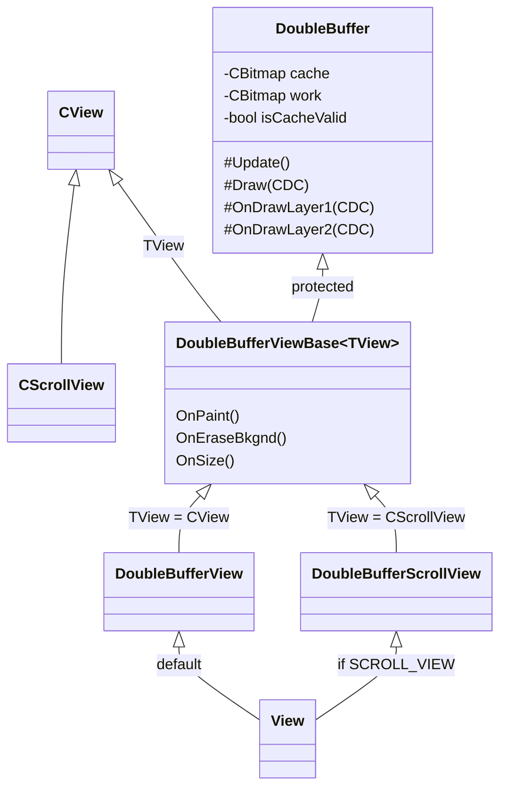

`DoubleBufferViewBase` is a class template over the MFC view class, so one implementation serves both `CView` and `CScrollView`. MFC message maps cannot be templates, so the handlers are in the template, and each concrete class (`DoubleBufferView`, `DoubleBufferScrollView`) has a message map in `DoubleBuffer.cpp`.

### Observer connections

Two independent Observer channels connect the parts. `Observable<THint>` / `Observer<THint>` (`Observer.h`) is a pair of small templates, and the hint type makes each channel type-safe.

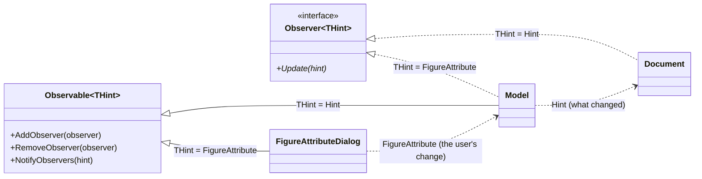

| Channel | Observable | Observer | Hint |
|---|---|---|---|
| Model changes | `Model` | `Document`, which calls `UpdateAllViews` | `Hint`: `Added` / `Removed` / `Changed` / `All` / `ViewOnly` + the affected figures |
| Attribute edits | `FigureAttributeDialog` | `Model` | `FigureAttribute` with only the edited item valid |

## Walkthroughs

### 1. Drawing a figure (input to model)

#### From mouse messages to the command

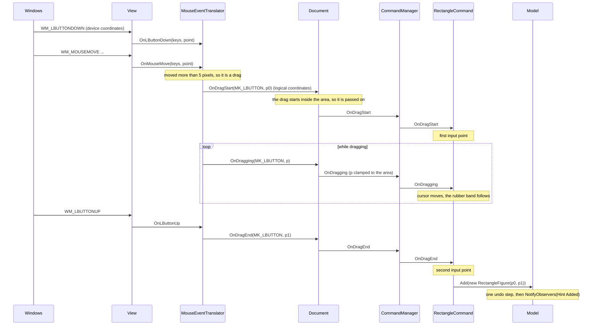

1. `View` forwards the raw mouse messages to `MouseEventTranslator`.
2. `MouseEventTranslator` decides whether the press is a click or a drag, and converts device points to logical points (`Geometry::DPtoLP`, which uses the view's `OnPrepareDC`).
3. `Document` checks that the drag starts inside the drawing area, then forwards it to `CommandManager`. Points during the drag are clamped to the area, so the command always gets the drag end.
4. `CommandManager` forwards it to the current `Command`. `AddFigureCommand` collects points, creates the figure, and calls `Model::Add`.

To add a tool, write a new `Command` subclass. Nothing else in the input pipeline changes.

#### How `MouseEventTranslator` tells a click from a drag

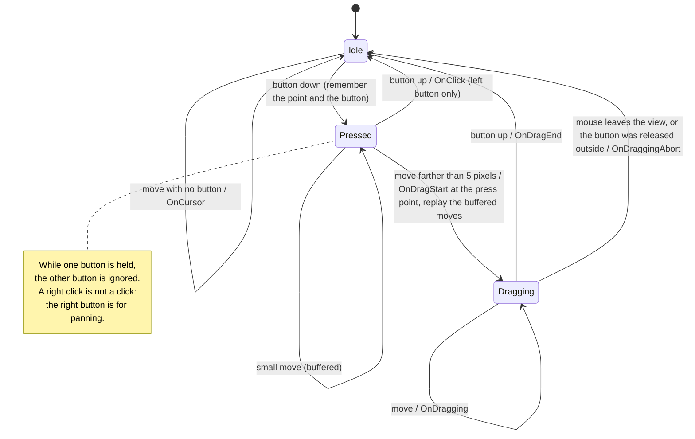

The listener sees the drag start at the point where the button was **pressed**, not where the drag was detected. The buffered moves are replayed, so no part of the path is lost.

#### How an `AddFigureCommand` collects points (click input)

Click input and drag input share this logic: a drag start and a drag end are two inputs. The diagram is for a two-point tool (Line, Rectangle, Ellipse). A Dot needs only one click.

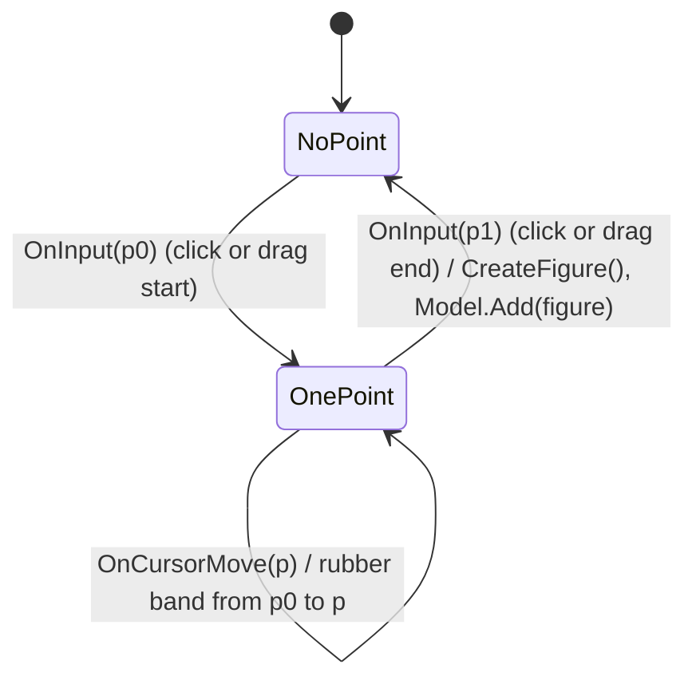

While it waits for the second point, the command draws a **preview figure** (`GetFigure`) with the current attribute, from `p0` to the cursor. The preview is a member of the command and is redrawn on every paint (layer 2). The final figure (`CreateFigure`) is allocated with `new` and handed to the model, which owns it from then on.

### 2. The model changes (model to screen)

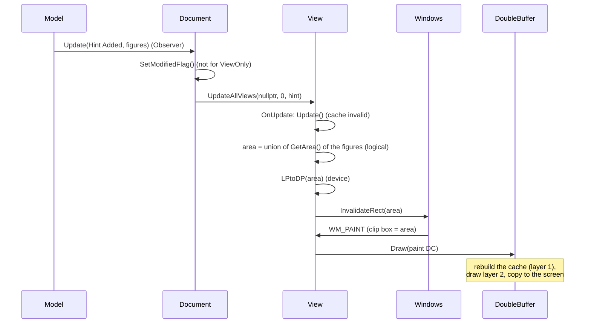

- Every change to `Model` (and every selection change) ends with `NotifyObservers(Hint(...))`. The hint type tells the view how much to redraw:

  | Hint type | Sent by | View redraws | Sets the modified flag |
  |---|---|---|---|
  | `Added` | `Add`, `Paste`, Random | the area of the new figures | yes |
  | `Removed` | `RemoveSelectedFigures` | the area of the removed figures | yes |
  | `Changed` | attribute change | the area of the old **and** new figures (a thicker pen makes a figure larger) | yes |
  | `All` | `Undo`, `Redo`, file load | everything | yes |
  | `ViewOnly` | selection changes, the attribute for new figures, `Reset` (from `DeleteContents`, before File > New / Open), and `Paste` (after `Added`, for the selection) | everything | no |

- The model never calls the view directly, which is why `Model` can be tested without a window.
- The highlight of the Select tool is not a model change: `Model::Highlight` only remembers the figure, and the view redraws because `View::OnMouseMove` invalidates the window on every mouse move.

### 3. Selecting figures

A click with the Select tool toggles the selection of the nearest figure. The dialog then shows the combined attribute of the selection.

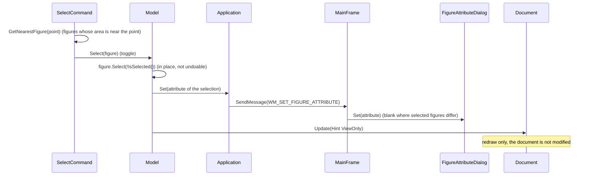

The attribute sent to the dialog depends on the selection (`Model::GetAttribute`): the figure's own attribute for one figure, the combined attribute (`FigureAttribute::GetSum`) for several, and the attribute for new figures when nothing is selected.

`GetNearestFigure` first skips figures whose area (`GetArea()`, the bounding rectangle padded for the pen and the markers) does not overlap the square that extends 100 logical units from the point in each direction. Among the rest, it picks the one with the smallest `GetDistanceFrom`. While the cursor moves, `SelectCommand` highlights that figure (its bounding rectangle is drawn) and shows its distance next to the cursor (see the screenshot). A drag selects every figure whose area is completely inside the dragged rectangle and deselects the others. The rectangle is drawn with an XOR pen.

### 4. Undo / redo

`Model` keeps its figures in `shos::undo_redo_pointer_vector<Figure>` (`undo_redo_vector.h`):

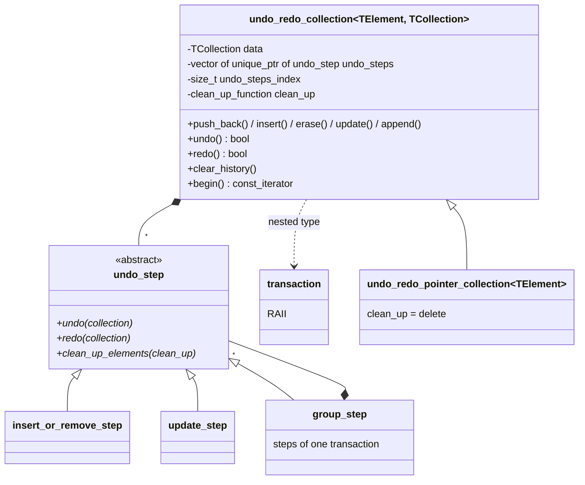

Each change is recorded as an **undo step** that can revert and reapply itself (the Command pattern again, at the data level). `undo_steps_index` separates the done steps from the undone (redo) ones:

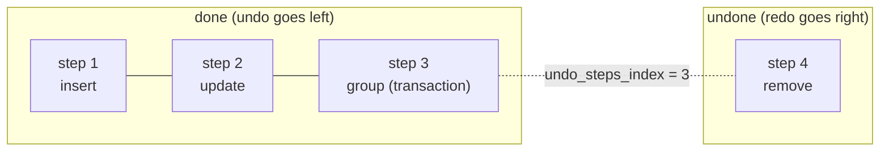

A new change after an undo discards the redo part (step 4 here). Only then are the figures held only by those steps deleted.

How changing a figure becomes undoable (`Model::Update`, called when the user edits an attribute in the dialog):

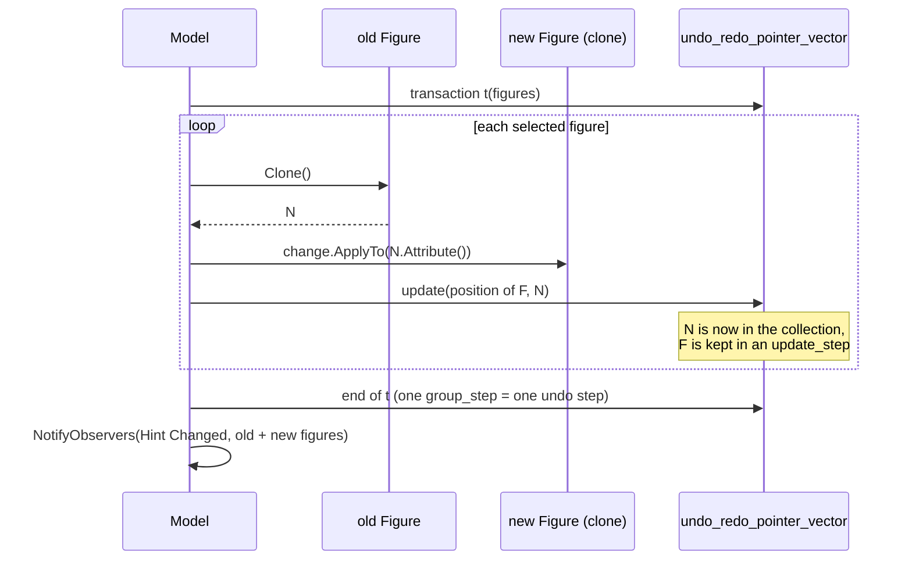

The rules that come from this design:

- **Elements are read-only.** Iterators are always `const_iterator`. To change a figure, `Clone()` it, edit the clone and `update` the slot (see `Model::Update`). The old figure stays in the history, so undo puts it back. (Selection is the exception: it changes the figure in place and is not undoable.)
- **Transactions.** A RAII `transaction` object groups several steps into one undo unit, for example deleting five selected figures. Transactions can be nested; only the outermost one creates the step. While a transaction is open, `undo()` / `redo()` return `false`.
- **Ownership.** The container owns the pointers and deletes each figure exactly once, when it can no longer come back: when its redo history is discarded, when the history is dropped (`clear_history()`, e.g. after loading a file), on `reset()`, or when the container is destroyed. After you pass a `Figure*` to the model, never delete it yourself.
- **Exception safety.** If `push_back`, `insert` or `update` throws, the collection and its history are unchanged, and the element passed in has been cleaned up. With `std::vector`, `undo()` / `redo()` never allocate. Element types must be nothrow movable and swappable (the `undo_redo_element` concept).

The container is independent of MFC and of this application, so you can reuse it.

### 5. Flicker-free drawing

`View` derives from `DoubleBufferView` (or `DoubleBufferScrollView`) in `DoubleBuffer.h`, and draws in two layers instead of in `OnDraw`:

| Layer | Content | When it is drawn |
|---|---|---|
| `OnDrawLayer1` | drawing area and figures | into a cached, client-sized bitmap, only after `Update()` invalidates it |
| `OnDrawLayer2` | the current tool's rubber band and cursor | on every `WM_PAINT`, on top of the cache |

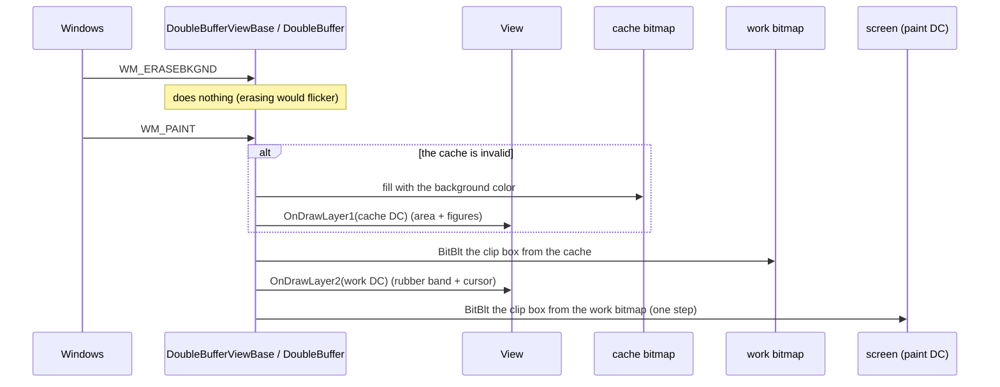

Moving the mouse invalidates the whole window (`View::OnMouseMove`), but the figures are not drawn again: each paint is two `BitBlt`s from the cache plus layer 2. That stays fast and flicker-free even with many figures. A model change invalidates only the area of the affected figures, so only that clip box is processed. The two bitmaps are recreated only when the client size changes. If they cannot be created (e.g. out of memory), the view is drawn straight to the screen: it may flicker, but it is still correct.

### 6. Coordinates, zooming and panning

- **Logical coordinates** are model coordinates. The drawing area is 2000 × 2000. Figures, commands and hit-testing all use logical coordinates.
- **Device coordinates** are client-area pixels. Mouse messages and `InvalidateRect` use device coordinates.
- `View::OnPrepareDC` sets the mapping between them. With `ZOOMING_VIEW` (the default), `Zooming` maps the visible part of the area (`logicalArea`) to the whole client area with `MM_ISOTROPIC`, keeping the aspect ratio:

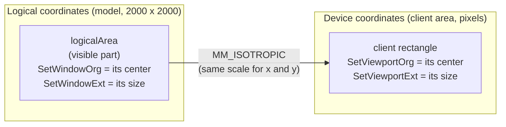

Zooming changes `logicalArea` and nothing else:

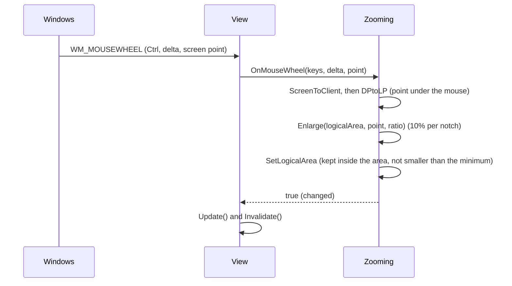

Panning (a right-button drag) moves `logicalArea` so that the point under the mouse follows the mouse. The cross-hair cursor and its message text are converted from device to logical units when drawn (`Cursor` in `Command.h`), so they keep the same size on screen at any zoom. Figures, including their pen widths and selection markers, are in logical units and scale with the zoom.

You can change the view type with the macros at the top of `View.h`. Define at most one of them: to use the scroll view, comment out `#define ZOOMING_VIEW` and uncomment `#define SCROLL_VIEW`.

| Macro | Base class | Behavior |
|---|---|---|
| `ZOOMING_VIEW` (default) | `DoubleBufferView` | zoom with `Ctrl` + wheel, pan with a right drag |
| `SCROLL_VIEW` | `DoubleBufferScrollView` | scroll bars, `MM_TEXT`, no zoom |
| neither | `DoubleBufferView` | the whole area always fits the window |

### 7. Clipboard and serialization

**Copy** (`ClipboardHelper.h`) puts three formats on the clipboard at once, so every kind of application can take something:

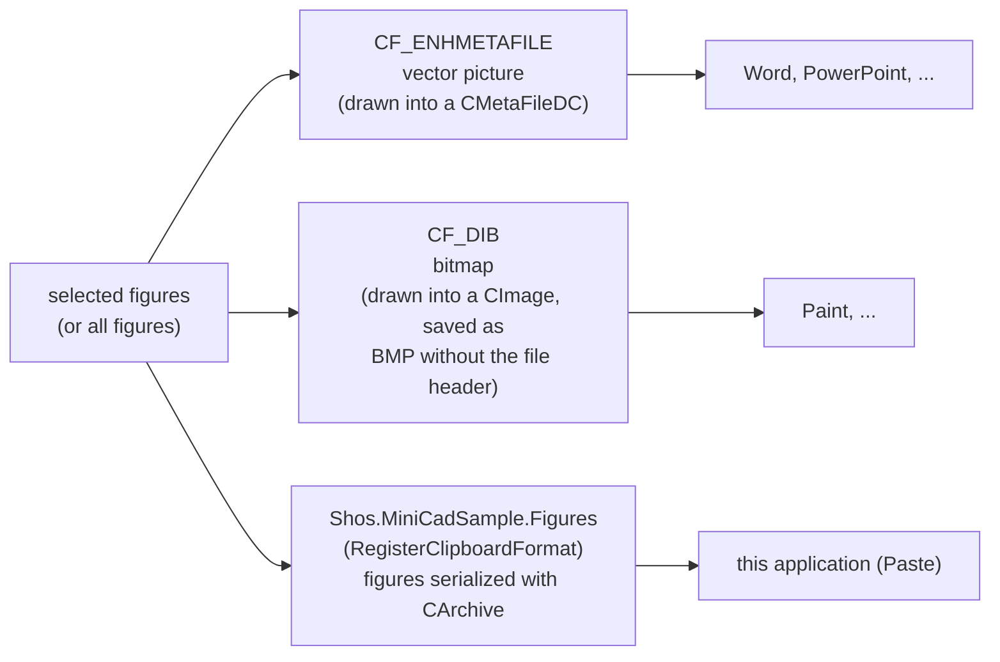

**Paste** reads the custom format, and `Model::Paste` is all-or-nothing:

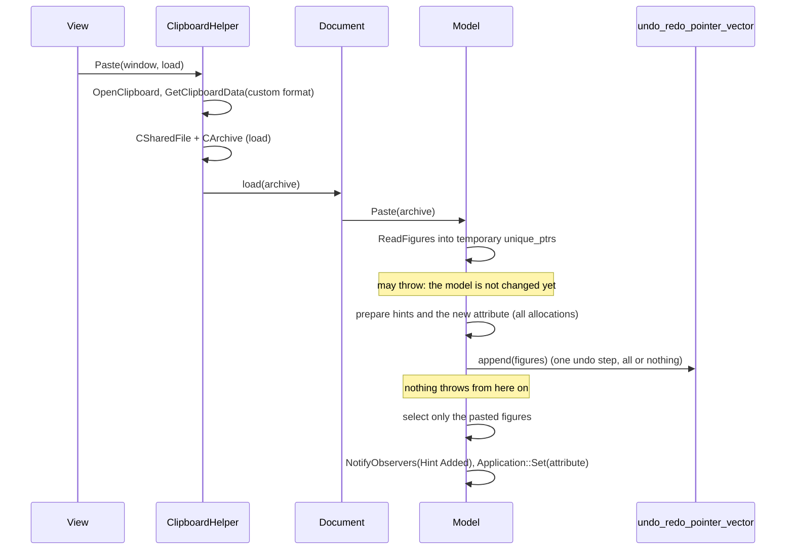

A broken clipboard therefore leaves the model unchanged and leaks nothing. The tests check this by making each allocation fail in turn. **Cut** is Copy followed by `RemoveSelectedFigures`, so it is undoable too. Unlike Copy, it is enabled only when figures are selected.

**Files** use the same serialization (`Model::Serialize`): a figure count followed by `ar.WriteObject(figure)` for each figure. `CArchive` writes the class name the first time each class appears, and `IMPLEMENT_SERIAL` lets it re-create the right subclass when reading. After loading, the undo history is cleared. Files and clipboard data store **unqualified** class names (`"RectangleFigure"`), so the C++ namespaces do not change the data format.

### 8. The modeless attribute dialog

`FigureAttribute` has a color and a pen width, each with a *valid* flag. The dialog shows the combined attribute of the selected figures (`GetSum`). An item where the figures differ is invalid and shown blank.

When you edit one item, the dialog sends a *change* with only that item valid:

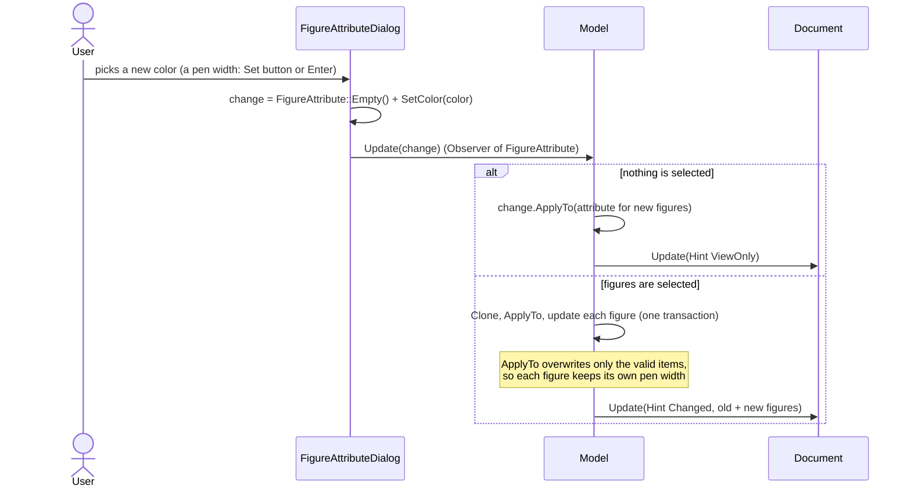

Figures that already have the new value are not replaced, so they add nothing to the undo step. The dialog does not know the model: `View` registers the model as the dialog's observer through `Application::SetFigureAttributeObserver`.

## Suggested reading order

1. `Observer.h`, `Geometry.h`: small utilities used everywhere.
2. `FigureAttribute.h`, `Figure.h`: the data. Note `Clone()` and serialization.
3. `Model.h`: how figures are added, changed, selected, undone and pasted, and how changes are notified.
4. `undo_redo_vector.h`: the container behind undo/redo. Read its overview comment first.
5. `MouseEventTranslator.h`, `Command.h`, `Document.h`: the input path from mouse to model.
6. `DoubleBuffer.h`, `Zooming.h`, `View.h`: drawing, coordinates and the view.
7. `ClipboardHelper.h`, `FigureAttributeDialog.h`, `MainFrame.h`, `Application.h`: the rest of the UI.
8. The tests: `ModelTest.cpp`, `MouseEventTranslatorTest.cpp` and `Shos.MiniCadSample.Test.cpp` show the intended behavior, including the exception-safety checks.

## Exercises

- **Add a new figure type**, for example a rounded rectangle or a polyline:
  1. Add a `Figure` subclass in `Figure.h`. Implement `Clone`, `DrawShape`, `GetShapeArea` / `GetDistanceFrom` and `Serialize`, and add `DECLARE_SERIAL`.
  2. Add `IMPLEMENT_SERIAL` in `Figure.cpp`.
  3. Add a `Command` subclass in `Command.h`.
  4. Add a menu item and handlers in `Document.h` / `Document.cpp`.
- **Make selection undoable.** Hint: selection is currently changed in place.
- **Move the selected figures by dragging** with the Select tool, as one undo step per drag.
- **Draw the new figure into the cache only**, using `DoubleBuffer::CacheDevice`, instead of rebuilding the whole cache after an add.

## Repository layout

```
Shos.MiniCadSample/                 the application
Shos.MiniCadSample.Test/            unit tests
Shos.MiniCadSample.MemoryLeakTest/  memory leak check of the undo/redo container
Documents/images/                   screenshot
Reviews/, Plans/                    design review and fix plan (Japanese)
CLAUDE.md                           notes on the architecture and conventions
```

## License

[MIT License](LICENSE.txt)
